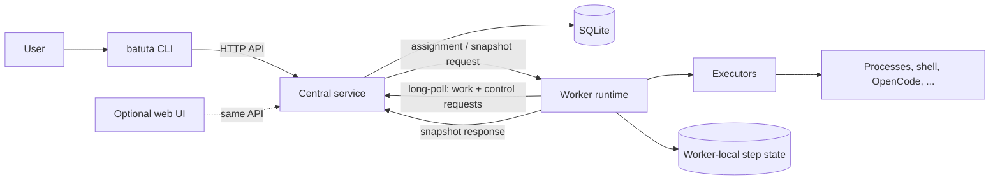

# Batuta

**A CLI-first orchestrator for distributed tasks and heterogeneous workers.**

Batuta coordinates work across machines and environments. You describe a task as a
versioned, structured definition; the central service schedules it; a worker runs its
steps locally and keeps the runtime state; and the CLI shows what actually happened —
step by step, without invented progress percentages.

> **Status:** pre-alpha. The repository is in the design and documentation phase. No
> functional implementation exists yet. See the [roadmap](docs/ROADMAP.md).

---

## Why Batuta

Most automation tools assume one of two extremes: a single machine running shell
commands, or a full container orchestration platform. Batuta targets the space between
them:

- You have several machines, not necessarily identical.
- Some work must run close to the code, the network, or the hardware.
- You want a visible, auditable record of each attempt.
- You do not want to run Kubernetes, a message broker, or a database cluster to
  coordinate a handful of jobs.

Batuta is deliberately small: a central service, a CLI, and a worker runtime. SQLite is
the default store. HTTP is the default transport. Everything else is an adapter.

## How it works



1. You create a **Task** with a project, requirements, and a versioned list of **Steps**.
2. The central service schedules an **Execution** on a compatible **Worker**.
3. The worker receives the execution plan, validates it, and runs the steps.
4. The worker owns the runtime state of its steps and persists it locally.
5. The central service **queries** that state through an explicit protocol and records
   the last observed snapshot, with a timestamp and a stale marker.
6. The CLI reads the central service and displays steps, results, logs, and artifacts.

The worker does not push routine step progress to the central service. Heartbeats exist
only for liveness and connectivity. See
[the worker protocol](docs/architecture/worker-protocol.md).

## Core concepts

| Concept | Meaning |
| --- | --- |
| **Project** | A namespace for tasks and defaults. |
| **Task** | A request for work: requirements, priority, dependencies, continuity policy, and a versioned step plan. |
| **Execution** | One concrete attempt to run a task on one worker. Retries create new executions. |
| **Step** | A unit inside an execution plan. The central service defines it; the worker owns its runtime state. |
| **Worker** | A registered environment with capabilities, labels, and a local runtime. |
| **Snapshot** | The worker's coherent view of an execution and its steps at a point in time. |
| **Artifact** | A file or resource produced by an execution, referenced rather than inlined. |
| **Executor** | An adapter that runs something: a structured process, an explicit shell, OpenCode, Git, etc. |

## Example

Define a task:

```yaml
apiVersion: batuta/v1
kind: Task
metadata:
  project: demo
  name: test-and-package
spec:
  continuity: CONTINUE_ON_ERROR
  steps:
    - id: deps
      name: Download dependencies
      executor:
        type: process
        executable: go
        args: ["mod", "download"]
        cwd: /workspace/app
    - id: test
      name: Run tests
      dependsOn: [deps]
      executor:
        type: process
        executable: go
        args: ["test", "./..."]
        cwd: /workspace/app
        timeout: 15m
```

Run it:

```console
$ batuta server start --config ./batuta.yaml
$ batuta project create demo
$ batuta task apply -f task.yaml
tsk_01JQ8Z6K3M8Y4W2A7C9E1F5G0R
$ batuta worker join --service http://127.0.0.1:8080 --token "$BATUTA_ENROLLMENT_TOKEN"
$ batuta worker run --config ./worker.yaml
$ batuta task watch tsk_01JQ8Z6K3M8Y4W2A7C9E1F5G0R
STEP   NAME                    STATE      STARTED   FINISHED
deps   Download dependencies   COMPLETED  12:00:01  12:00:08
test   Run tests               RUNNING    12:00:09  —
```

More examples: [CLI session](docs/examples/cli-session.md),
[task definition](docs/examples/task.yaml), [worker configuration](docs/examples/worker.yaml),
and [snapshot payload](docs/examples/snapshot.json).

## Design principles

- **Explicit ownership.** The central service owns Task and Execution state. The worker
  owns the runtime state of the steps it runs. Neither side pretends to own the other's
  data.
- **Pull, don't push.** Work assignment and state observation are request-driven. There
  are no spontaneous step-progress notifications.
- **Structured by default.** Commands are executable + args + cwd + env, not shell
  strings. Shell is an explicit, policy-gated executor.
- **Failure is data.** Skipped steps have reasons. Partial success is a distinct result.
  Failures are never converted into silent success.
- **Small MVP.** Go, `net/http`, SQLite, YAML configuration, JSON over HTTP. No broker,
  no distributed database, no service mesh.
- **Adapters at the edges.** OpenCode, Git, Docker, and shell are integrations, not
  domain concepts.

## Planned repository layout

```text
cmd/batuta/                 # single binary entrypoint
internal/
  domain/                   # entities, state machines, invariants
  app/                      # use cases and orchestration
  store/                    # SQLite repositories and migrations
  httpapi/                  # central HTTP API
  worker/                   # worker runtime, local state, snapshot provider
  executor/                 # process, shell, and future adapters
  protocol/                 # versioned wire contracts
  config/                   # configuration loading and validation
  cli/                      # command-line interface
contracts/                  # JSON schemas / OpenAPI (when implemented)
docs/                       # architecture, roadmap, issues, examples
```

## Roadmap and work breakdown

The [roadmap](docs/ROADMAP.md) describes the incremental phases and exit criteria. The
[current work breakdown](docs/issues/README.md) maps every phase to small, reviewable
issues with context, scope, acceptance criteria, and validation.

## Documentation

- [Architecture overview](docs/architecture/overview.md)
- [Domain model](docs/architecture/domain-model.md)
- [Worker protocol](docs/architecture/worker-protocol.md)
- [Execution and steps](docs/architecture/execution-and-steps.md)
- [Architecture decisions](docs/architecture/decisions.md)
- [Examples](docs/examples/)

## Contributing

Read [CONTRIBUTING.md](https://github.com/iniciativa-batuta/.github/blob/main/CONTRIBUTING.md)
and the organization [standards](https://github.com/iniciativa-batuta/.github/tree/main/docs/standards).
Issues and pull requests use the organization-wide templates. Keep changes scoped,
document behavior changes, and run the checks listed in the relevant issue.

## Security

Do not open a public issue for a vulnerability. Follow the organization
[security policy](https://github.com/iniciativa-batuta/.github/blob/main/SECURITY.md).

## License

AGPL-3.0. See [LICENSE](LICENSE).

## Name and trademark

**Batuta** is the working product name. The name is not yet cleared for trademark
registration or commercial launch. Do not make public brand commitments before the name
is reviewed.
