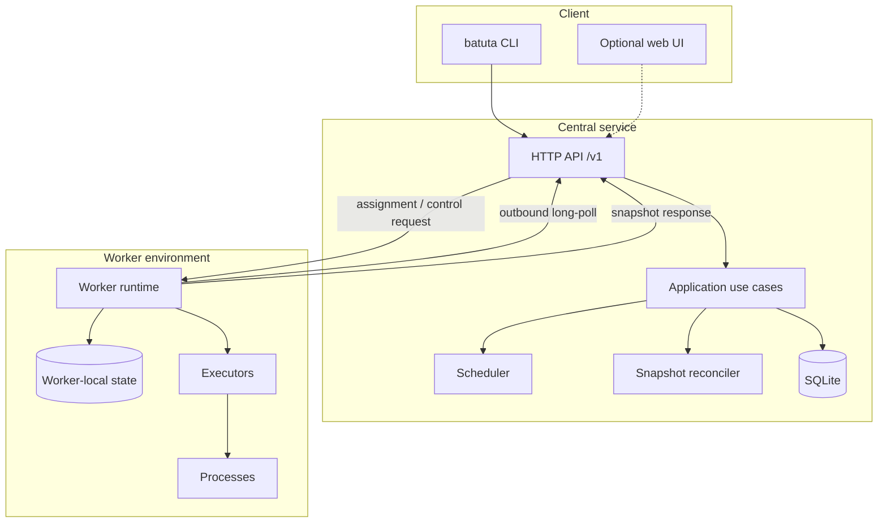
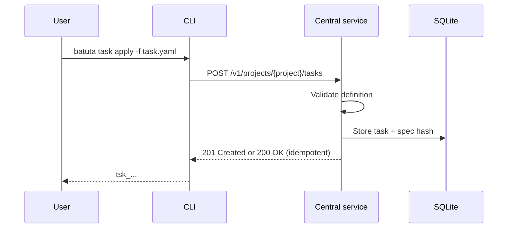
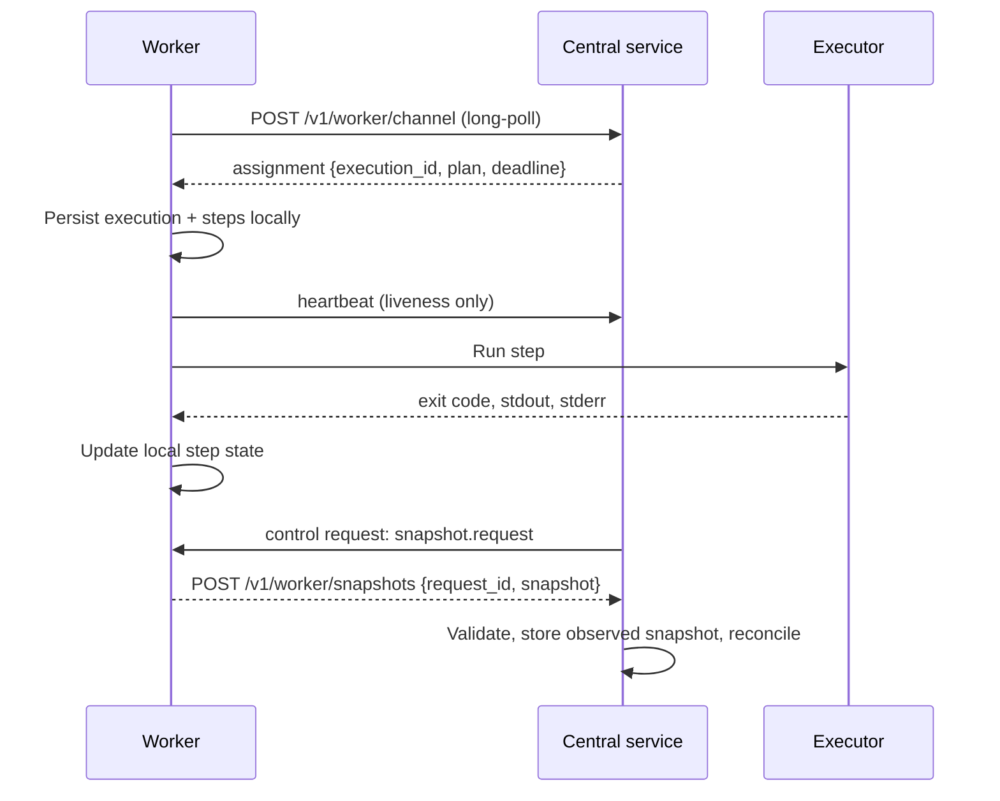

# Architecture overview

## Purpose

Batuta coordinates tasks across machines that may differ in operating system,
architecture, installed tooling, and network reachability. It is not a container
orchestrator, a CI system, or an agent framework. It is a small control plane with a
clear execution boundary and an explicit observation protocol.

## System context

The worker always initiates network connections. This is a deliberate constraint: the
central service must not assume it can open an inbound connection to a worker behind
NAT, a firewall, or a private network.

## Components

### Central service (`batuta server`)

- Owns the authoritative state of Projects, Tasks, Executions, and Workers.
- Validates task definitions and freezes an immutable execution plan per execution.
- Selects compatible workers and creates assignments.
- Requests snapshots from workers for active executions and records the last observed
  snapshot with `observed_at` and a staleness flag.
- Enforces authentication, authorization, limits, and audit rules.
- Exposes a versioned HTTP API. It does not execute task steps.

### CLI (`batuta ...`)

- The primary product interface.
- A client of the central API. It contains no scheduling, persistence, or execution
  rules.
- Administers projects, tasks, executions, workers, logs, artifacts, and audit events.
- Provides worker administrative commands that call the worker's local service, not a
  separate implementation of the protocol.

### Worker runtime (`batuta worker run`)

- Registers an environment and maintains liveness.
- Receives assignments and control requests through an outbound long-poll channel.
- Validates the execution plan against its capabilities and policy.
- Runs steps locally through executors.
- Owns and persists the runtime state of its steps.
- Serves snapshots when the central service requests them.
- Never invents, removes, or reorders steps defined by the central service.

### Executors

Executors are adapters behind a narrow interface. The MVP includes:

- `process`: structured executable + args + cwd + environment + timeout.
- `shell`: explicit shell script execution, disabled by default and policy-gated.

OpenCode, Git, Docker, and other integrations are later adapters. The domain does not
depend on any of them.

## Data ownership

| Data | Owner | Notes |
| --- | --- | --- |
| Project definition | Central service | Persistent. |
| Task definition and official Task state | Central service | Persistent. |
| Execution record and official Execution state | Central service | Persistent. |
| Execution plan (step definitions, order, dependencies, executor specs) | Central service | Immutable per execution version. |
| Runtime Step state | Worker | Persisted locally; observed by the central service. |
| Last observed snapshot | Central service | Explicitly a copy with `observed_at`; may be stale. |
| Artifacts | Central service (metadata + storage) | Produced by workers, referenced by executions. |
| Audit events | Central service | Append-only for sensitive operations. |

This split prevents the central service from reporting step progress it has not observed
and prevents a worker from redefining what the task was supposed to do.

## Primary flows

### 1. Create and apply a task

Applying the same definition twice with the same project and name is idempotent. A
changed definition creates a new task revision or is rejected as a conflict; the exact
rule is defined in the task API issue.

### 2. Assign and execute

### 3. Observe status

The central service schedules snapshot requests for every active execution. The
interval is configurable and bounded. A snapshot contains the execution state and all
step states as the worker knows them at `observed_at`. The central service records the
snapshot and presents it as an observation, not as a live stream.

### 4. Cancel

`batuta task cancel` records a cancellation request. The central service delivers an
`execution.cancel` control request through the worker channel. The worker terminates
the running process group, marks running steps `CANCELLED`, marks unstarted steps
`SKIPPED` with `CANCELLED_BY_USER`, and reports the result in the next snapshot. If the
worker is unreachable, the documented timeout and final state are defined in
[execution-and-steps.md](execution-and-steps.md).

## Runtime topologies

### Local

Central service, CLI, and worker on one machine. The channel still uses the normal
outbound connection, even if it points to loopback. This keeps one protocol path in
tests.

### LAN or private network

The worker connects outbound to the central service. The central service may optionally
use a direct worker endpoint if the worker advertises a reachable address, but the
channel-based snapshot request remains the portable default.

### NAT or restricted egress

Only outbound connections from the worker are available. The long-poll channel carries
both work assignments and control requests, including snapshot requests. The worker
responds with an explicit snapshot POST. This is a central-service-initiated pull
carried over a worker-initiated connection, not a worker progress notification.

### Central service unavailable

The worker keeps running the current execution and persists state locally. It retries
the channel with exponential backoff and jitter. When the central service returns, it
requests a snapshot and reconciles. The worker does not discard completed step state
because the control plane was down.

## Trust boundaries

1. **User/CLI to central service.** Authenticated by an admin token in the MVP. TLS is
   required outside loopback.
2. **Worker to central service.** Authenticated by a per-worker credential issued at
   enrollment. A worker may only act on its own assignments and executions.
3. **Central service to worker.** Every request is authenticated and scoped. The worker
   never accepts unauthenticated control requests.
4. **Worker to executed process.** The worker is a privilege boundary. It enforces
   allowed working roots, executor policy, environment handling, timeouts, and output
   limits. Executed code is not trusted to respect those limits by itself.
5. **Integrations.** Git, OpenCode, and other adapters receive only the credentials and
   workspace access explicitly granted by worker policy.

## Technology baseline

- **Language:** Go, standard library first.
- **Transport:** HTTP/1.1 with JSON; HTTPS outside loopback.
- **Persistence:** SQLite in WAL mode with embedded migrations.
- **Configuration:** YAML with environment overrides; secrets referenced by file or
  environment, never embedded in task definitions.
- **CLI:** standard library `flag` with a small command tree; revisit a CLI framework if
  the command surface grows beyond what is maintainable.
- **IDs:** prefixed ULIDs, for example `tsk_01JQ8Z6K3M8Y4W2A7C9E1F5G0R`.

No broker, external database, container platform, or service mesh is part of the MVP.
Those are not forbidden forever; they require a demonstrated requirement.

## Non-goals for the MVP

- Parallel step execution and dynamic step creation.
- A general DAG engine with fan-out/fan-in.
- Multi-tenant RBAC, OAuth/OIDC, or SSO.
- High availability of the central service.
- Object storage integration (S3, GCS).
- A web interface.
- Git and OpenCode integrations.
- Automatic task retry policies.
- Distributed consensus.

## MVP checklist

The MVP is complete when all of the following are demonstrated:

1. Start the central service.
2. Register a worker.
3. Create a task through the CLI.
4. Assign an execution to a compatible worker.
5. Deliver a versioned execution plan with steps.
6. Execute at least one real process.
7. Update step states locally on the worker.
8. Query the worker through the protocol and obtain a coherent snapshot.
9. Inspect task, execution, and progress through the CLI.
10. Demonstrate `FAIL_FAST` and `CONTINUE_ON_ERROR`.
11. Recover from worker unavailability, worker restart, and repeated snapshot queries
    according to the documented guarantees.

The MVP must work with both a local worker and a remote worker reachable only through
outbound connections.

## Related documents

- [Domain model](domain-model.md)
- [Worker protocol](worker-protocol.md)
- [Execution and steps](execution-and-steps.md)
- [Decisions](decisions.md)
