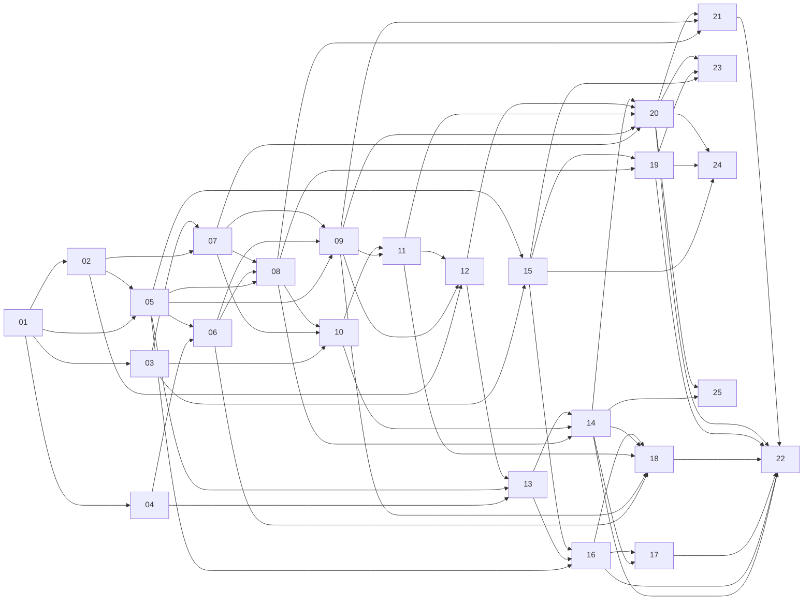

# Issue work breakdown

Each file in this directory is a self-contained, reviewable issue. The first heading is
the issue title. The sections follow the organization issue standard: Context, Objective,
Scope, Out of scope, Acceptance criteria, Dependencies, Technical notes, and Validation.

The same content is published as GitHub issues. When an issue changes, update the
Markdown file and the GitHub issue together.

## Index

| # | Issue | Phase | Type / area | Priority | Depends on |
| --- | --- | --- | --- | --- | --- |
| 01 | [Bootstrap the Go module and binary skeleton](0001-bootstrap-go-module.md) | 1 | chore / core | p1 | — |
| 02 | [Define versioned contracts, identifiers, and the error model](0002-versioned-contracts.md) | 1 | feature / protocol | p1 | 01 |
| 03 | [Implement configuration loading and validation](0003-configuration-loading.md) | 1 | feature / core | p1 | 01 |
| 04 | [Add SQLite storage, core schema, and migrations](0004-sqlite-storage.md) | 1 | feature / storage | p1 | 01 |
| 05 | [Implement the domain model and state machines](0005-domain-model.md) | 2 | feature / core | p1 | 01, 02 |
| 06 | [Implement repositories and transition persistence tests](0006-repositories.md) | 2 | feature / storage | p1 | 04, 05 |
| 07 | [Build the central HTTP API foundation](0007-http-api-foundation.md) | 3 | feature / api | p1 | 02, 03 |
| 08 | [Implement project and task APIs with idempotent apply](0008-project-task-apis.md) | 3 | feature / api | p1 | 05, 06, 07 |
| 09 | [Implement worker enrollment, registry, and execution read APIs](0009-worker-registry-apis.md) | 3 | feature / api, worker | p1 | 05, 06, 07 |
| 10 | [Build the CLI client foundation and project/task commands](0010-cli-client-foundation.md) | 3 | feature / cli | p1 | 03, 07, 08 |
| 11 | [Implement worker enrollment, credential storage, and heartbeat](0011-worker-enrollment-heartbeat.md) | 4 | feature / worker, security | p1 | 09, 10 |
| 12 | [Implement the worker work acquisition and control channel](0012-worker-channel.md) | 4 | feature / worker, protocol | p1 | 02, 09, 11 |
| 13 | [Implement worker-local step state and snapshot generation](0013-worker-local-state.md) | 4 | feature / worker | p1 | 04, 05, 12 |
| 14 | [Implement snapshot reconciliation and status views](0014-snapshot-reconciliation.md) | 4 | feature / worker, cli | p1 | 08, 10, 13 |
| 15 | [Implement the structured process executor and explicit shell executor](0015-structured-process-executor.md) | 5 | feature / execution | p1 | 03, 05 |
| 16 | [Implement the step runner and continuity profiles](0016-step-runner-continuity.md) | 5 | feature / execution | p1 | 05, 13, 15 |
| 17 | [Implement timeout, cancellation, restart, and offline recovery semantics](0017-timeout-cancel-recovery.md) | 5 | feature / execution | p1 | 14, 16 |
| 18 | [Implement the scheduler with capabilities, priority, and dependencies](0018-scheduler.md) | 6 | feature / scheduler | p1 | 06, 09, 11, 14, 16 |
| 19 | [Implement payload and artifact envelopes with limits](0019-payloads-artifacts.md) | 7 | feature / storage | p1 | 08, 15 |
| 20 | [Harden worker authentication, transport security, and secret handling](0020-security-hardening.md) | 7 | security / security | p0 | 07, 09, 11, 12, 14 |
| 21 | [Add an append-only audit trail for sensitive operations](0021-audit-trail.md) | 7 | security / security | p1 | 08, 09, 20 |
| 22 | [Validate the MVP end to end with local and remote workers](0022-mvp-end-to-end.md) | 8 | chore / core | p1 | 14, 16, 17, 18, 19, 20, 21 |
| 23 | [Add an optional Git integration adapter](0023-git-integration.md) | 9 | feature / integrations | p2 | 15, 19, 20 |
| 24 | [Add an optional OpenCode executor adapter](0024-opencode-executor.md) | 9 | feature / integrations | p2 | 15, 19, 20 |
| 25 | [Add an optional web interface](0025-optional-web-interface.md) | 9 | feature / web | p2 | 14, 20 |

## Dependency graph

## Working agreement

- Do not start an issue whose dependencies are not complete unless the blocking part is
  explicitly stubbed and the stub is documented.
- Keep one deliverable per issue. If a change needs another deliverable, create a new
  issue or update the scope before starting.
- Every pull request references its issue and includes the validation commands that were
  actually run.
- Acceptance criteria are behavioral. "Code exists" is not a criterion.
- If implementation reveals a decision that contradicts
  [decisions.md](../architecture/decisions.md), update the decision document in the same
  pull request.
